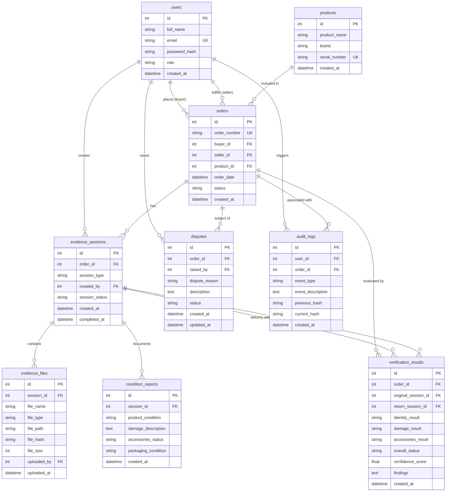

# ReturnProof Relational Database Architecture & Schema Specification
**Version:** 2.0.0 (Day 1, Prompt 2)  
**Database Engines Supported:** SQLite 3 (Development/Testing), Azure SQL Database / MSSQL (Production)  
**ORM:** SQLAlchemy 2.0+ Declarative Mapping  
**Migration Tool:** Alembic 1.13+  

---

## 1. Architecture Overview

ReturnProof implements a secure, verifiable digital chain-of-custody data model for e-commerce deliveries, unboxing, and returns. The database maintains referential integrity across the purchase lifecycle, capturing immutable media evidence, tamper-evident hash chaining, condition assessments, and automated AI verification results.

### Core Domain Clusters
1. **Identity & Access Management:** `users`
2. **Catalog & Commercial Transaction:** `products`, `orders`
3. **Chain-of-Custody Evidence Capture:** `evidence_sessions`, `evidence_files`, `condition_reports`
4. **AI Verification & Resolution:** `verification_results`, `disputes`
5. **Tamper-Evident Ledger:** `audit_logs`

---

## 2. Entity-Relationship (ER) Diagram



---

## 3. Detailed Table Specifications

### 3.1 `users`
Represents buyers, sellers, and system administrators.

| Column | Type | Constraints | Description |
|---|---|---|---|
| `id` | `INTEGER` | `PRIMARY KEY AUTOINCREMENT` | Unique identifier for user |
| `full_name` | `VARCHAR(255)` | `NOT NULL` | User's full legal/display name |
| `email` | `VARCHAR(255)` | `NOT NULL, UNIQUE, INDEX` | Lowercase login email address |
| `password_hash` | `VARCHAR(255)` | `NOT NULL` | Argon2id cryptographic password hash |
| `role` | `VARCHAR(50)` | `NOT NULL, DEFAULT 'buyer'` | Role: `'buyer'`, `'seller'`, or `'admin'` |
| `created_at` | `DATETIME(TZ)` | `NOT NULL, DEFAULT NOW()` | UTC timestamp of account creation |

---

### 3.2 `products`
Physical items tracked through the chain-of-custody.

| Column | Type | Constraints | Description |
|---|---|---|---|
| `id` | `INTEGER` | `PRIMARY KEY AUTOINCREMENT` | Unique identifier for product |
| `product_name` | `VARCHAR(255)` | `NOT NULL` | Name or model of the product |
| `brand` | `VARCHAR(255)` | `NULLABLE` | Brand or manufacturer name |
| `serial_number` | `VARCHAR(255)` | `NULLABLE, UNIQUE, INDEX` | Hardware serial number / IMEI |
| `created_at` | `DATETIME(TZ)` | `NOT NULL, DEFAULT NOW()` | UTC timestamp of product record creation |

---

### 3.3 `orders`
Commercial transaction linking buyer, seller, and product.

| Column | Type | Constraints | Description |
|---|---|---|---|
| `id` | `INTEGER` | `PRIMARY KEY AUTOINCREMENT` | Unique identifier for order |
| `order_number` | `VARCHAR(100)` | `NOT NULL, UNIQUE, INDEX` | Unique customer reference number (e.g. `ORD-...`) |
| `buyer_id` | `INTEGER` | `NOT NULL, FK(users.id ON DELETE CASCADE), INDEX` | User ID of the buyer |
| `seller_id` | `INTEGER` | `NULLABLE, FK(users.id ON DELETE SET NULL), INDEX` | User ID of the seller |
| `product_id` | `INTEGER` | `NULLABLE, FK(products.id ON DELETE SET NULL), INDEX` | Product ID being sold |
| `order_date` | `DATETIME(TZ)` | `NOT NULL, DEFAULT NOW()` | UTC timestamp when order was placed |
| `status` | `VARCHAR(50)` | `NOT NULL, DEFAULT 'pending'` | Lifecycle status (`pending`, `shipped`, `delivered`, etc.) |
| `created_at` | `DATETIME(TZ)` | `NOT NULL, DEFAULT NOW()` | UTC record creation timestamp |

---

### 3.4 `evidence_sessions`
Encapsulates an evidence gathering session for delivery unboxing or return inspection.

| Column | Type | Constraints | Description |
|---|---|---|---|
| `id` | `INTEGER` | `PRIMARY KEY AUTOINCREMENT` | Unique session identifier |
| `order_id` | `INTEGER` | `NOT NULL, FK(orders.id ON DELETE CASCADE), INDEX` | Associated order identifier |
| `session_type` | `VARCHAR(50)` | `NOT NULL, INDEX` | Session type: `'delivery'` or `'return'` |
| `created_by` | `INTEGER` | `NULLABLE, FK(users.id ON DELETE SET NULL), INDEX` | User who initiated the session |
| `session_status` | `VARCHAR(50)` | `NOT NULL, DEFAULT 'active', INDEX` | Status: `'active'`, `'completed'`, `'cancelled'` |
| `created_at` | `DATETIME(TZ)` | `NOT NULL, DEFAULT NOW()` | Session start timestamp (UTC) |
| `completed_at` | `DATETIME(TZ)` | `NULLABLE` | Timestamp when session was finalized |

---

### 3.5 `evidence_files`
Immutable digital evidence media (photos, continuous unboxing video, label scans).

| Column | Type | Constraints | Description |
|---|---|---|---|
| `id` | `INTEGER` | `PRIMARY KEY AUTOINCREMENT` | Unique file identifier |
| `session_id` | `INTEGER` | `NOT NULL, FK(evidence_sessions.id ON DELETE CASCADE), INDEX` | Parent evidence session |
| `file_name` | `VARCHAR(255)` | `NOT NULL` | Original filename |
| `file_type` | `VARCHAR(100)` | `NOT NULL` | MIME type (e.g. `image/jpeg`, `video/mp4`) |
| `file_path` | `VARCHAR(500)` | `NOT NULL` | Relative file storage path or cloud blob key |
| `file_hash` | `VARCHAR(64)` | `NOT NULL, INDEX` | SHA-256 cryptographic digest of the file bytes |
| `file_size` | `INTEGER` | `NOT NULL` | File size in bytes |
| `uploaded_by` | `INTEGER` | `NULLABLE, FK(users.id ON DELETE SET NULL), INDEX` | User who uploaded the evidence |
| `uploaded_at` | `DATETIME(TZ)` | `NOT NULL, DEFAULT NOW()` | Upload timestamp (UTC) |

---

### 3.6 `condition_reports`
Structured physical assessment of the package and item condition during a session.

| Column | Type | Constraints | Description |
|---|---|---|---|
| `id` | `INTEGER` | `PRIMARY KEY AUTOINCREMENT` | Unique report identifier |
| `session_id` | `INTEGER` | `NOT NULL, FK(evidence_sessions.id ON DELETE CASCADE), INDEX` | Parent evidence session |
| `product_condition` | `VARCHAR(100)` | `NOT NULL` | Assessment (`brand_new`, `like_new`, `damaged`, etc.) |
| `damage_description` | `TEXT` | `NULLABLE` | Detailed narrative of physical defects or damage |
| `accessories_status` | `VARCHAR(100)` | `NULLABLE` | Status (`all_present`, `missing_charger`, etc.) |
| `packaging_condition`| `VARCHAR(100)` | `NULLABLE` | Seal and packaging integrity state |
| `created_at` | `DATETIME(TZ)` | `NOT NULL, DEFAULT NOW()` | Report generation timestamp (UTC) |

---

### 3.7 `verification_results`
Comparative analysis between original delivery evidence and return inspection.

| Column | Type | Constraints | Description |
|---|---|---|---|
| `id` | `INTEGER` | `PRIMARY KEY AUTOINCREMENT` | Unique verification identifier |
| `order_id` | `INTEGER` | `NOT NULL, FK(orders.id ON DELETE CASCADE), INDEX` | Evaluated order |
| `original_session_id`| `INTEGER` | `NULLABLE, FK(evidence_sessions.id ON DELETE SET NULL), INDEX` | Delivery unboxing reference session |
| `return_session_id`  | `INTEGER` | `NULLABLE, FK(evidence_sessions.id ON DELETE SET NULL), INDEX` | Return inspection reference session |
| `identity_result` | `VARCHAR(50)` | `NOT NULL` | Identity outcome (`match`, `mismatch`, `inconclusive`) |
| `damage_result` | `VARCHAR(50)` | `NOT NULL` | Damage diff (`no_new_damage`, `customer_damage`, etc.) |
| `accessories_result` | `VARCHAR(50)` | `NOT NULL` | Accessories check (`all_returned`, `missing_items`) |
| `overall_status` | `VARCHAR(50)` | `NOT NULL, INDEX` | Verdict (`verified`, `flagged_for_review`, `rejected`) |
| `confidence_score` | `FLOAT` | `NULLABLE` | Confidence value between `0.0` and `1.0` |
| `findings` | `TEXT` | `NULLABLE` | AI / auditor diagnostic breakdown |
| `created_at` | `DATETIME(TZ)` | `NOT NULL, DEFAULT NOW()` | Verification execution timestamp (UTC) |

---

### 3.8 `disputes`
Formal claims raised by buyers or sellers regarding delivery or return conditions.

| Column | Type | Constraints | Description |
|---|---|---|---|
| `id` | `INTEGER` | `PRIMARY KEY AUTOINCREMENT` | Unique dispute identifier |
| `order_id` | `INTEGER` | `NOT NULL, FK(orders.id ON DELETE CASCADE), INDEX` | Order in dispute |
| `raised_by` | `INTEGER` | `NOT NULL, FK(users.id ON DELETE CASCADE), INDEX` | User who lodged the dispute |
| `dispute_reason` | `VARCHAR(255)` | `NOT NULL` | Headline reason for dispute |
| `description` | `TEXT` | `NOT NULL` | Detailed claim narrative |
| `status` | `VARCHAR(50)` | `NOT NULL, DEFAULT 'open', INDEX` | Status (`open`, `under_review`, `resolved`, `rejected`) |
| `created_at` | `DATETIME(TZ)` | `NOT NULL, DEFAULT NOW()` | Dispute creation timestamp (UTC) |
| `updated_at` | `DATETIME(TZ)` | `NOT NULL, DEFAULT NOW()` | Last update timestamp (UTC) |

---

### 3.9 `audit_logs`
Tamper-evident, cryptographically chained audit ledger of key system events.

| Column | Type | Constraints | Description |
|---|---|---|---|
| `id` | `INTEGER` | `PRIMARY KEY AUTOINCREMENT` | Unique audit log entry identifier |
| `user_id` | `INTEGER` | `NULLABLE, FK(users.id ON DELETE SET NULL), INDEX` | Actor who performed the action |
| `order_id` | `INTEGER` | `NULLABLE, FK(orders.id ON DELETE SET NULL), INDEX` | Associated order context |
| `event_type` | `VARCHAR(100)` | `NOT NULL, INDEX` | Event classification (`ORDER_PLACED`, `EVIDENCE_UPLOADED`, etc.) |
| `event_description` | `TEXT` | `NOT NULL` | Detailed description of the recorded action |
| `previous_hash` | `VARCHAR(64)` | `NULLABLE` | SHA-256 hash of previous record (`NULL` for genesis) |
| `current_hash` | `VARCHAR(64)` | `NOT NULL` | SHA-256 hash of `previous_hash + event + payload` |
| `created_at` | `DATETIME(TZ)` | `NOT NULL, DEFAULT NOW()` | Timestamp of event recording (UTC) |

---

## 4. Database Migration Instructions

### Applying Migrations Locally (SQLite)

```powershell
# 1. Navigate to backend directory
cd backend

# 2. Activate virtual environment
.\venv\Scripts\Activate.ps1

# 3. Apply all pending migrations to the database
alembic upgrade head
```

### Checking Current Migration Status

```powershell
alembic current
```

### Generating a New Migration

```powershell
alembic revision --autogenerate -m "describe_changes"
```

### Migrating to Azure SQL Database

To migrate to Azure SQL Database:
1. Update `DATABASE_URL` in `backend/.env` with your Azure connection string:
   ```ini
   DATABASE_URL="mssql+pyodbc://<username>:<password>@<your-server>.database.windows.net/<database_name>?driver=ODBC+Driver+18+for+SQL+Server"
   ```
2. Run Alembic upgrade:
   ```powershell
   cd backend
   alembic upgrade head
   ```
Alembic will automatically construct all 9 tables, indexes, and foreign keys on Azure SQL without manual DDL scripting.
