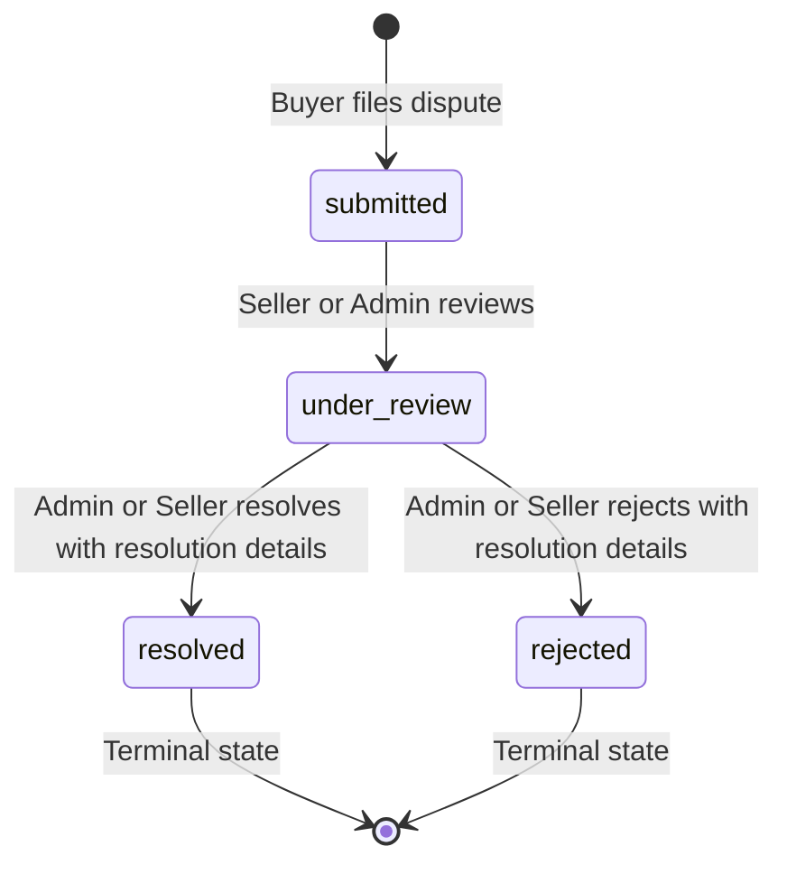

# ReturnProof API: Dispute Management & PDF Evidence Reports

This document provides complete technical specifications for the Dispute Management and PDF Evidence Report endpoints in ReturnProof API v1.

---

## 1. Overview & Architecture

ReturnProof enables tamper-evident chain-of-custody tracking. When discrepancies, damaged items, or missing components occur, the platform provides:
- **Dispute Lifecycle Management**: Formal dispute filing by buyers, structured investigation review by sellers and platform administrators, and terminal resolution (`resolved` / `rejected`).
- **Cryptographic Audit Trail**: All dispute lifecycle events (`DISPUTE_CREATED`, `DISPUTE_MOVED_TO_REVIEW`, `DISPUTE_RESOLVED`, `DISPUTE_REJECTED`) are recorded in the SHA-256 hash-linked audit ledger.
- **PDF Evidence Report Compilation**: Programmatically compiled multi-page PDF documents generated with ReportLab, featuring dynamic `NumberedCanvas` page numbering ("Page X of Y"), comprehensive order timelines, physical delivery and unboxing evidence logs, AI verification matrices, and legal evidentiary limitations.
- **SHA-256 Document Integrity**: Every generated PDF report receives a unique SHA-256 checksum at generation time, verified upon download.
- **Strict Role-Based Access Control (RBAC)**: All resources enforce strict tenant separation between buyers, sellers, and administrators.

---

## 2. Dispute Management

### 2.1 Enums & Allowed Values

#### Dispute Reasons (`dispute_reason`)
- `Product returned damaged`
- `Missing accessories`
- `Product identity mismatch`
- `Packaging issue`
- `Incorrect return`
- `Other`

#### Dispute Statuses (`status`)
- `submitted` (Initial state upon creation)
- `under_review` (Under formal investigation by seller or admin)
- `resolved` (Terminal state: claim resolved/upheld)
- `rejected` (Terminal state: claim rejected/denied)

#### State Transition Rules

> [!NOTE]
> - A dispute cannot jump directly from `submitted` to `resolved`/`rejected` without entering `under_review`.
> - Once in `resolved` or `rejected`, the dispute reaches a terminal state and cannot be modified.
> - Only one active dispute (`submitted` or `under_review`) can exist per order. Attempting to file another returns `409 Conflict`.

---

### 2.2 Dispute Endpoints

#### `POST /api/v1/disputes`
File a new dispute against an order. Only the buyer who purchased the order or an admin can file a dispute.

**Request Headers:**
```http
Authorization: Bearer <jwt_access_token>
Content-Type: application/json
```

**Request Body (`DisputeCreate`):**
```json
{
  "order_id": 14,
  "dispute_reason": "Product returned damaged",
  "description": "Outer casing cracked and display unresponsive upon return package opening."
}
```

**Response (`201 Created` - `DisputeResponse`):**
```json
{
  "id": 8,
  "order_id": 14,
  "raised_by": 2,
  "dispute_reason": "Product returned damaged",
  "description": "Outer casing cracked and display unresponsive upon return package opening.",
  "status": "submitted",
  "resolution_details": null,
  "created_at": "2026-11-07T13:40:00.000000Z",
  "updated_at": "2026-11-07T13:40:00.000000Z"
}
```

**Error Responses:**
- `400 Bad Request`: Validation failure.
- `403 Forbidden`: Authenticated user is not the buyer of the specified order.
- `404 Not Found`: Order not found.
- `409 Conflict`: An active dispute already exists for this order.
- `422 Unprocessable Entity`: Invalid `dispute_reason`.

---

#### `GET /api/v1/disputes`
List disputes accessible to the authenticated user.
- **Buyer**: Sees only disputes they created.
- **Seller**: Sees only disputes filed against orders where they are the seller.
- **Admin**: Sees all disputes across the platform.

**Query Parameters:**
| Parameter | Type | Required | Description |
|-----------|------|----------|-------------|
| `order_id` | integer | No | Filter by specific order ID |
| `status` | string | No | Filter by status (`submitted`, `under_review`, `resolved`, `rejected`) |
| `skip` | integer | No | Pagination offset (default: 0) |
| `limit` | integer | No | Pagination limit (default: 50, max: 100) |

**Response (`200 OK` - `List[DisputeResponse]`):**
```json
[
  {
    "id": 8,
    "order_id": 14,
    "raised_by": 2,
    "dispute_reason": "Product returned damaged",
    "description": "Outer casing cracked and display unresponsive.",
    "status": "submitted",
    "resolution_details": null,
    "created_at": "2026-11-07T13:40:00.000000Z",
    "updated_at": "2026-11-07T13:40:00.000000Z"
  }
]
```

---

#### `GET /api/v1/disputes/{dispute_id}`
Retrieve complete detail and order metadata for a specific dispute.

**Response (`200 OK` - `DisputeDetailResponse`):**
```json
{
  "id": 8,
  "order_id": 14,
  "raised_by": 2,
  "dispute_reason": "Product returned damaged",
  "description": "Outer casing cracked and display unresponsive.",
  "status": "under_review",
  "resolution_details": null,
  "created_at": "2026-11-07T13:40:00.000000Z",
  "updated_at": "2026-11-07T13:45:00.000000Z",
  "order": {
    "id": 14,
    "order_number": "ORD-2026-90412",
    "status": "returned",
    "buyer_id": 2,
    "seller_id": 3,
    "product_id": 7
  }
}
```

---

#### `PATCH /api/v1/disputes/{dispute_id}/status`
Transition the status of a dispute.
- **Allowed Roles**: Seller of the order or Admin. Buyers cannot transition status.

**Request Body (`DisputeStatusUpdate`):**
```json
{
  "status": "resolved",
  "resolution_details": "Claim approved. Seller credited via platform protection fund and buyer refunded."
}
```

**Response (`200 OK` - `DisputeResponse`):**
```json
{
  "id": 8,
  "order_id": 14,
  "raised_by": 2,
  "dispute_reason": "Product returned damaged",
  "description": "Outer casing cracked and display unresponsive.",
  "status": "resolved",
  "resolution_details": "Claim approved. Seller credited via platform protection fund and buyer refunded.",
  "created_at": "2026-11-07T13:40:00.000000Z",
  "updated_at": "2026-11-07T14:10:00.000000Z"
}
```

---

#### `GET /api/v1/orders/{order_id}/disputes`
List all disputes associated with a particular order.

**Response (`200 OK` - `List[DisputeResponse]`)**

---

## 3. PDF Evidence Reports

### 3.1 Report Architecture & Features

The ReturnProof PDF report engine creates court-admissible, institutional-grade documentation:
1. **NumberedCanvas Two-Pass Pagination**: Accurately computes total page counts, stamping running headers and footers ("ReturnProof Chain of Custody Report | Page X of Y").
2. **Order & Party Specifications**: Summarizes buyer, seller, order tracking, and timestamp.
3. **Delivery Evidence Session**: Lists outbound delivery images, SHA-256 hashes, timestamps, and geolocation tags.
4. **Return Evidence Session**: Unboxing and inspection records, package integrity, and physical condition.
5. **Automated Verification Findings**: AI comparison scores (structural similarity, serial match, cosmetic condition, tampering flags).
6. **Cryptographic Audit Log**: Chronological ledger of transactional events with previous block hashes.
7. **Dispute Records**: Full timeline of dispute filings, review notes, and resolution actions.
8. **Evidentiary Limitations & Legal Disclaimer**: Standardized disclaimer regarding automated analysis boundaries.
9. **Private File Storage**: PDF files are stored in `backend/uploads/reports/` with unique filenames, not accessible via public URL. Download requires authenticated streaming with ownership checks.

---

### 3.2 Report Endpoints

#### `POST /api/v1/reports/orders/{order_id}/generate`
Compiles and generates a new ReportLab PDF report for the specified order.

**Request Headers:**
```http
Authorization: Bearer <jwt_access_token>
Content-Type: application/json
```

**Request Body (`ReportGenerateRequest`):**
```json
{
  "report_type": "full_chain_of_custody"
}
```
*(Available report types: `evidence_summary`, `full_chain_of_custody`, `dispute_arbitration`)*

**Response (`201 Created` - `ReportResponse`):**
```json
{
  "id": 5,
  "order_id": 14,
  "generated_by": 2,
  "report_type": "full_chain_of_custody",
  "file_name": "ReturnProof-Evidence-Report-ORD-2026-90412-v1.pdf",
  "file_size": 42180,
  "file_hash": "e3b0c44298fc1c149afbf4c8996fb92427ae41e4649b934ca495991b7852b855",
  "version": 1,
  "status": "completed",
  "created_at": "2026-11-07T14:15:00.000000Z"
}
```

---

#### `GET /api/v1/reports/orders/{order_id}`
Retrieves metadata for the latest generated PDF report for an order.

**Response (`200 OK` - `ReportResponse`)**

---

#### `GET /api/v1/reports/{report_id}`
Retrieves metadata for a specific report by ID.

**Response (`200 OK` - `ReportResponse`)**

---

#### `GET /api/v1/reports/{report_id}/download`
Securely streams the compiled PDF binary file to the client.
- **Content-Type**: `application/pdf`
- **Content-Disposition**: `attachment; filename="ReturnProof-Evidence-Report-..."`

---

#### `GET /api/v1/reports/order/{order_id}/pdf`
Direct streaming shortcut: returns the latest report PDF for the given order, or generates one on-the-fly if not yet compiled.

---

## 4. RBAC Matrix

| Role | File Dispute | View Own Disputes | View Order Disputes | Update Dispute Status | Generate PDF Report | Download PDF Report |
|---|---|---|---|---|---|---|
| **Buyer** | Own orders only | Yes | Own orders only | No | Own orders only | Own orders only |
| **Seller** | No | Orders sold | Orders sold | `under_review`, `resolved`, `rejected` | Orders sold | Orders sold |
| **Admin** | Any order | All | All | All statuses | Any order | Any order |

---

## 5. cURL Integration Examples

### File a Dispute (Buyer)
```bash
curl -X POST "http://localhost:8000/api/v1/disputes" \
  -H "Authorization: Bearer $BUYER_TOKEN" \
  -H "Content-Type: application/json" \
  -d '{
    "order_id": 14,
    "dispute_reason": "Product returned damaged",
    "description": "Item casing cracked on return."
  }'
```

### Move Dispute to Review (Seller)
```bash
curl -X PATCH "http://localhost:8000/api/v1/disputes/8/status" \
  -H "Authorization: Bearer $SELLER_TOKEN" \
  -H "Content-Type: application/json" \
  -d '{
    "status": "under_review"
  }'
```

### Resolve Dispute (Admin)
```bash
curl -X PATCH "http://localhost:8000/api/v1/disputes/8/status" \
  -H "Authorization: Bearer $ADMIN_TOKEN" \
  -H "Content-Type: application/json" \
  -d '{
    "status": "resolved",
    "resolution_details": "Dispute resolved in buyer favor. Replacement dispatched."
  }'
```

### Generate & Download PDF Report
```bash
# 1. Generate Report
curl -X POST "http://localhost:8000/api/v1/reports/orders/14/generate" \
  -H "Authorization: Bearer $BUYER_TOKEN" \
  -H "Content-Type: application/json" \
  -d '{"report_type": "full_chain_of_custody"}'

# 2. Download Binary PDF
curl -X GET "http://localhost:8000/api/v1/reports/5/download" \
  -H "Authorization: Bearer $BUYER_TOKEN" \
  -o "ReturnProof-Evidence-Report-14.pdf"
```

