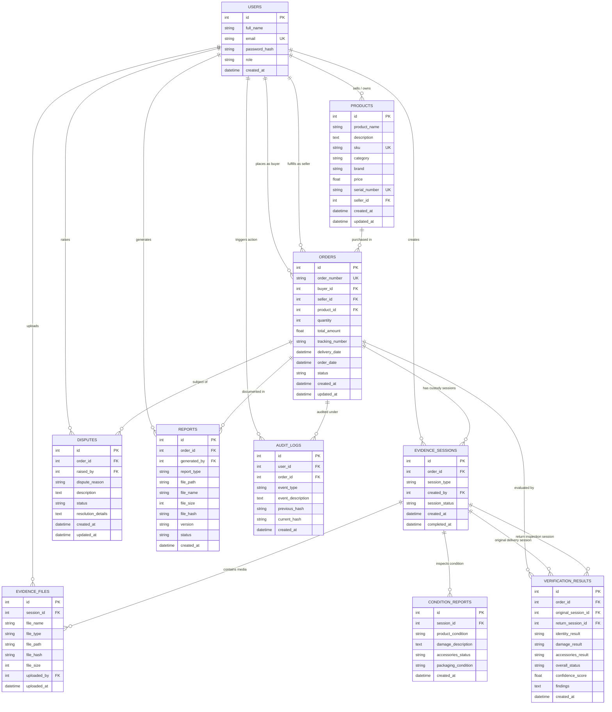

# VELO — COMPREHENSIVE DATABASE MANAGEMENT SYSTEM (DBMS) DOCUMENTATION

**Date of Publication:** November 8, 2026  
**Auditor / Architect:** Velo Data Engineering & Lead Systems Architect  
**Database Engines:** SQLite 3 (Development / Single-Node Pilot) & Azure SQL / PostgreSQL (Production Target)  
**ORM & Migration Framework:** SQLAlchemy 2.0 (Mapped Declarative) & Alembic 1.13  
**Target Codebase:** Velo E-Commerce Chain-of-Custody & Return Verification Platform  

---

## 1. Database Overview

The Velo data tier is engineered to support an immutable, tamper-evident digital chain-of-custody for e-commerce transactions, physical deliveries, unboxing recordings, return condition verification, and dispute resolution.

### Architectural Philosophy
1. **Relational Integrity with Strict Constraints:** The domain enforces strict multi-tenant isolation (buyers, sellers, administrators) across 10 core relational entities with explicit foreign key cascading rules (`CASCADE` vs. `SET NULL`).
2. **Surrogate Key Uniformity:** Every entity utilizes an auto-incrementing integer surrogate primary key (`id`) alongside indexed business identifiers (e.g., `order_number`, `sku`, `serial_number`, `file_hash`).
3. **Cryptographic Immutability:** Audit records (`audit_logs`) and evidence files (`evidence_files`) incorporate cryptographic SHA-256 digests. Audit events are linked sequentially where each record cryptographically anchors the digest of the preceding record ($H_i = \text{SHA-256}(H_{i-1} \parallel \dots)$).
4. **Dual-Dialect SQLAlchemy 2.0 Architecture:** Database interaction uses modern SQLAlchemy 2.0 type-annotated declarative models (`Mapped[...]`, `mapped_column(...)`). Engine initialization in `backend/app/database/connection.py` dynamically configures connection pooling (`QueuePool`, `pool_pre_ping=True`, `pool_recycle=1800`) for cloud engines while disabling thread checks (`check_same_thread=False`) for SQLite development.

---

## 2. Entity-Relationship (ER) Diagram

The following Mermaid entity-relationship diagram illustrates all 10 domain entities, their primary keys, foreign keys, and structural associations.



---

## 3. Actual Relational Schema

Extracted directly from `backend/app/models/*.py` and verified via SQLite schema pragmas in `returnproof.db`.

### 3.1 Table: `users`
Represents registered system actors: buyers, merchants (sellers), and dispute administrators.

| Column Name | Data Type | Nullable | Default | Constraints & Modifiers | Description |
| :--- | :--- | :---: | :---: | :--- | :--- |
| `id` | `INTEGER` | **No** | Auto | `PRIMARY KEY AUTOINCREMENT` | Unique user identifier. |
| `full_name` | `VARCHAR(255)` | **No** | — | — | User's full legal/display name. |
| `email` | `VARCHAR(255)` | **No** | — | `UNIQUE`, `INDEX` | Authentication credential. |
| `password_hash` | `VARCHAR(255)` | **No** | — | — | RFC 9106 Argon2id hash. |
| `role` | `VARCHAR(50)` | **No** | `'buyer'` | — | Role: `buyer`, `seller`, `admin`. |
| `created_at` | `DATETIME` | **No** | `now()` | Server default `CURRENT_TIMESTAMP` | Account creation timestamp. |

---

### 3.2 Table: `products`
Catalog of physical products registered by merchants for chain-of-custody tracking.

| Column Name | Data Type | Nullable | Default | Constraints & Modifiers | Description |
| :--- | :--- | :---: | :---: | :--- | :--- |
| `id` | `INTEGER` | **No** | Auto | `PRIMARY KEY AUTOINCREMENT` | Unique product identifier. |
| `product_name` | `VARCHAR(255)` | **No** | — | — | Commercial item title. |
| `description` | `TEXT` | Yes | `NULL` | — | Detailed specifications. |
| `sku` | `VARCHAR(100)` | Yes | `NULL` | `UNIQUE`, `INDEX` | Stock Keeping Unit code. |
| `category` | `VARCHAR(100)` | Yes | `NULL` | `INDEX` | Catalog classification category. |
| `brand` | `VARCHAR(255)` | Yes | `NULL` | — | Manufacturer / Brand name. |
| `price` | `FLOAT` | **No** | `0.0` | Server default `'0.0'` | Listed unit price. |
| `serial_number` | `VARCHAR(255)` | Yes | `NULL` | `UNIQUE`, `INDEX` | Factory hardware serial number. |
| `seller_id` | `INTEGER` | Yes | `NULL` | `FK -> users(id) ON DELETE SET NULL`, `INDEX` | Merchant owning the inventory. |
| `created_at` | `DATETIME` | **No** | `now()` | Server default `CURRENT_TIMESTAMP` | Product creation timestamp. |
| `updated_at` | `DATETIME` | **No** | `now()` | Server default `CURRENT_TIMESTAMP` | Last modification timestamp. |

---

### 3.3 Table: `orders`
Purchase agreements governing chain-of-custody between a buyer and merchant.

| Column Name | Data Type | Nullable | Default | Constraints & Modifiers | Description |
| :--- | :--- | :---: | :---: | :--- | :--- |
| `id` | `INTEGER` | **No** | Auto | `PRIMARY KEY AUTOINCREMENT` | Unique internal order identifier. |
| `order_number` | `VARCHAR(100)` | **No** | — | `UNIQUE`, `INDEX` | Business identifier (`ORD-YYYYMMDD-XXXXXX`). |
| `buyer_id` | `INTEGER` | **No** | — | `FK -> users(id) ON DELETE CASCADE`, `INDEX` | Purchasing buyer account. |
| `seller_id` | `INTEGER` | Yes | `NULL` | `FK -> users(id) ON DELETE SET NULL`, `INDEX` | Fulfilling merchant account. |
| `product_id` | `INTEGER` | Yes | `NULL` | `FK -> products(id) ON DELETE SET NULL`, `INDEX` | Purchased product entity. |
| `quantity` | `INTEGER` | **No** | `1` | Server default `'1'` | Units purchased. |
| `total_amount` | `FLOAT` | **No** | `0.0` | Server default `'0.0'` | Total transaction amount. |
| `tracking_number` | `VARCHAR(100)` | Yes | `NULL` | `INDEX` | Carrier logistics tracking code. |
| `delivery_date` | `DATETIME` | Yes | `NULL` | — | Timestamp parcel was marked delivered. |
| `order_date` | `DATETIME` | **No** | `now()` | Server default `CURRENT_TIMESTAMP` | Transaction initiation timestamp. |
| `status` | `VARCHAR(50)` | **No** | `'pending'` | — | Order lifecycle state. |
| `created_at` | `DATETIME` | **No** | `now()` | Server default `CURRENT_TIMESTAMP` | Record creation timestamp. |
| `updated_at` | `DATETIME` | **No** | `now()` | Server default `CURRENT_TIMESTAMP` | Last status update timestamp. |

---

### 3.4 Table: `evidence_sessions`
Discrete capture workflows (`delivery` unboxing or `return` packing/intake).

| Column Name | Data Type | Nullable | Default | Constraints & Modifiers | Description |
| :--- | :--- | :---: | :---: | :--- | :--- |
| `id` | `INTEGER` | **No** | Auto | `PRIMARY KEY AUTOINCREMENT` | Unique session identifier. |
| `order_id` | `INTEGER` | **No** | — | `FK -> orders(id) ON DELETE CASCADE`, `INDEX` | Parent order context. |
| `session_type` | `VARCHAR(50)` | **No** | `'delivery'` | `INDEX` | Lifecycle phase: `delivery` or `return`. |
| `created_by` | `INTEGER` | Yes | `NULL` | `FK -> users(id) ON DELETE SET NULL`, `INDEX` | User initiating capture session. |
| `session_status` | `VARCHAR(50)` | **No** | `'active'` | `INDEX` | Status: `active`, `completed`, `cancelled`. |
| `created_at` | `DATETIME` | **No** | `now()` | Server default `CURRENT_TIMESTAMP` | Capture initiation timestamp. |
| `completed_at` | `DATETIME` | Yes | `NULL` | — | Session completion timestamp. |

---

### 3.5 Table: `evidence_files`
Immutable digital evidence media (photos, unboxing videos, receipts).

| Column Name | Data Type | Nullable | Default | Constraints & Modifiers | Description |
| :--- | :--- | :---: | :---: | :--- | :--- |
| `id` | `INTEGER` | **No** | Auto | `PRIMARY KEY AUTOINCREMENT` | Unique file record ID. |
| `session_id` | `INTEGER` | **No** | — | `FK -> evidence_sessions(id) ON DELETE CASCADE`, `INDEX` | Owning evidence session. |
| `file_name` | `VARCHAR(255)` | **No** | — | — | Sanitized original filename. |
| `file_type` | `VARCHAR(100)` | **No** | — | — | MIME type (`image/jpeg`, `video/mp4`, etc.). |
| `file_path` | `VARCHAR(500)` | **No** | — | — | Relative disk storage path (`uploads/...`). |
| `file_hash` | `VARCHAR(64)` | **No** | — | `INDEX` | SHA-256 binary digest. |
| `file_size` | `INTEGER` | **No** | — | — | Byte size of the ingested payload. |
| `uploaded_by` | `INTEGER` | Yes | `NULL` | `FK -> users(id) ON DELETE SET NULL`, `INDEX` | User who uploaded the file. |
| `uploaded_at` | `DATETIME` | **No** | `now()` | Server default `CURRENT_TIMESTAMP` | Ingestion timestamp. |

---

### 3.6 Table: `condition_reports`
Structured physical inspection questionnaire accompanying an evidence session.

| Column Name | Data Type | Nullable | Default | Constraints & Modifiers | Description |
| :--- | :--- | :---: | :---: | :--- | :--- |
| `id` | `INTEGER` | **No** | Auto | `PRIMARY KEY AUTOINCREMENT` | Unique report identifier. |
| `session_id` | `INTEGER` | **No** | — | `FK -> evidence_sessions(id) ON DELETE CASCADE`, `INDEX` | Associated session. |
| `product_condition` | `VARCHAR(100)` | **No** | — | — | Condition: `unopened`, `good`, `damaged`, etc. |
| `damage_description`| `TEXT` | Yes | `NULL` | — | Free-text defect description. |
| `accessories_status` | `VARCHAR(100)`| Yes | `NULL` | — | Status of cables, manuals, accessories. |
| `packaging_condition`| `VARCHAR(100)`| Yes | `NULL` | — | Box seal, transit tear, tape status. |
| `created_at` | `DATETIME` | **No** | `now()` | Server default `CURRENT_TIMESTAMP` | Form submission timestamp. |

---

### 3.7 Table: `verification_results`
Algorithmic comparison records comparing delivery vs. return evidence.

| Column Name | Data Type | Nullable | Default | Constraints & Modifiers | Description |
| :--- | :--- | :---: | :---: | :--- | :--- |
| `id` | `INTEGER` | **No** | Auto | `PRIMARY KEY AUTOINCREMENT` | Unique verification identifier. |
| `order_id` | `INTEGER` | **No** | — | `FK -> orders(id) ON DELETE CASCADE`, `INDEX` | Target order. |
| `original_session_id`| `INTEGER` | Yes | `NULL` | `FK -> evidence_sessions(id) ON DELETE SET NULL`, `INDEX` | Baseline delivery session. |
| `return_session_id` | `INTEGER` | Yes | `NULL` | `FK -> evidence_sessions(id) ON DELETE SET NULL`, `INDEX` | Return inspection session. |
| `identity_result` | `VARCHAR(50)` | **No** | — | — | Item match score (`match`, `mismatch`). |
| `damage_result` | `VARCHAR(50)` | **No** | — | — | Visual divergence (`none`, `new_damage`). |
| `accessories_result` | `VARCHAR(50)` | **No** | — | — | Component checklist verification. |
| `overall_status` | `VARCHAR(50)` | **No** | — | `INDEX` | Final outcome (`verified`, `flagged`). |
| `confidence_score` | `FLOAT` | Yes | `NULL` | — | Statistical score ($0.0 \dots 1.0$). |
| `findings` | `TEXT` | Yes | `NULL` | — | Detailed divergence diagnostic. |
| `created_at` | `DATETIME` | **No** | `now()` | Server default `CURRENT_TIMESTAMP` | Analysis completion timestamp. |

---

### 3.8 Table: `disputes`
Formal claim records initiated by buyers or merchants for arbitration.

| Column Name | Data Type | Nullable | Default | Constraints & Modifiers | Description |
| :--- | :--- | :---: | :---: | :--- | :--- |
| `id` | `INTEGER` | **No** | Auto | `PRIMARY KEY AUTOINCREMENT` | Unique dispute ID. |
| `order_id` | `INTEGER` | **No** | — | `FK -> orders(id) ON DELETE CASCADE`, `INDEX` | Disputed order. |
| `raised_by` | `INTEGER` | **No** | — | `FK -> users(id) ON DELETE CASCADE`, `INDEX` | Claimant user ID. |
| `dispute_reason` | `VARCHAR(255)` | **No** | — | — | Taxonomy code (e.g. `damaged_item`). |
| `description` | `TEXT` | **No** | — | — | Claimant statement. |
| `status` | `VARCHAR(50)` | **No** | `'submitted'` | Server default `'submitted'`, `INDEX` | State: `submitted`, `under_review`, `resolved`, `rejected`. |
| `resolution_details`| `TEXT` | Yes | `NULL` | — | Arbitrator ruling notes. |
| `created_at` | `DATETIME` | **No** | `now()` | Server default `CURRENT_TIMESTAMP` | Filing timestamp. |
| `updated_at` | `DATETIME` | **No** | `now()` | Server default `CURRENT_TIMESTAMP` | Status change timestamp. |

---

### 3.9 Table: `reports`
Certified PDF evidence dossiers compiled for external arbitration and legal compliance.

| Column Name | Data Type | Nullable | Default | Constraints & Modifiers | Description |
| :--- | :--- | :---: | :---: | :--- | :--- |
| `id` | `INTEGER` | **No** | Auto | `PRIMARY KEY AUTOINCREMENT` | Unique report record ID. |
| `order_id` | `INTEGER` | **No** | — | `FK -> orders(id) ON DELETE CASCADE`, `INDEX` | Order being documented. |
| `generated_by` | `INTEGER` | Yes | `NULL` | `FK -> users(id) ON DELETE SET NULL`, `INDEX` | User triggering PDF compile. |
| `report_type` | `VARCHAR(50)` | **No** | `'evidence_dossier'` | Server default `'evidence_dossier'` | Dossier classification. |
| `file_path` | `VARCHAR(500)` | **No** | — | — | Physical PDF path on disk. |
| `file_name` | `VARCHAR(255)` | **No** | — | — | Formatted PDF filename. |
| `file_size` | `INTEGER` | **No** | `0` | Server default `'0'` | PDF size in bytes. |
| `file_hash` | `VARCHAR(64)` | **No** | — | — | SHA-256 digest of compiled PDF. |
| `version` | `VARCHAR(20)` | **No** | `'1.0'` | Server default `'1.0'` | Dossier layout schema version. |
| `status` | `VARCHAR(50)` | **No** | `'ready'` | Server default `'ready'` | Status (`ready`, `archived`). |
| `created_at` | `DATETIME` | **No** | `now()` | Server default `CURRENT_TIMESTAMP` | Generation timestamp. |

---

### 3.10 Table: `audit_logs`
Cryptographically hash-chained append-only digital ledger.

| Column Name | Data Type | Nullable | Default | Constraints & Modifiers | Description |
| :--- | :--- | :---: | :---: | :--- | :--- |
| `id` | `INTEGER` | **No** | Auto | `PRIMARY KEY AUTOINCREMENT` | Monotonically increasing sequence ID. |
| `user_id` | `INTEGER` | Yes | `NULL` | `FK -> users(id) ON DELETE SET NULL`, `INDEX` | Actor responsible for the event. |
| `order_id` | `INTEGER` | Yes | `NULL` | `FK -> orders(id) ON DELETE SET NULL`, `INDEX` | Order subject of event. |
| `event_type` | `VARCHAR(100)` | **No** | — | `INDEX` | Enumerated event action. |
| `event_description`| `TEXT` | **No** | — | — | Human-readable audit narrative. |
| `previous_hash` | `VARCHAR(64)` | Yes | `NULL` | — | SHA-256 hash of log $(i-1)$. |
| `current_hash` | `VARCHAR(64)` | **No** | — | — | SHA-256 hash of this record. |
| `created_at` | `DATETIME` | **No** | `now()` | Server default `CURRENT_TIMESTAMP` | Immutable event timestamp. |

---

## 4. Primary and Foreign Keys

| Entity Table | Primary Key | Foreign Key Column | Target Entity & Column | On Delete Action | On Update Action |
| :--- | :--- | :--- | :--- | :--- | :--- |
| `users` | `id` | — | — | — | — |
| `products` | `id` | `seller_id` | `users(id)` | `SET NULL` | `NO ACTION` |
| `orders` | `id` | `buyer_id` | `users(id)` | `CASCADE` | `NO ACTION` |
| `orders` | `id` | `seller_id` | `users(id)` | `SET NULL` | `NO ACTION` |
| `orders` | `id` | `product_id` | `products(id)` | `SET NULL` | `NO ACTION` |
| `evidence_sessions` | `id` | `order_id` | `orders(id)` | `CASCADE` | `NO ACTION` |
| `evidence_sessions` | `id` | `created_by` | `users(id)` | `SET NULL` | `NO ACTION` |
| `evidence_files` | `id` | `session_id` | `evidence_sessions(id)`| `CASCADE` | `NO ACTION` |
| `evidence_files` | `id` | `uploaded_by` | `users(id)` | `SET NULL` | `NO ACTION` |
| `condition_reports` | `id` | `session_id` | `evidence_sessions(id)`| `CASCADE` | `NO ACTION` |
| `verification_results`| `id`| `order_id` | `orders(id)` | `CASCADE` | `NO ACTION` |
| `verification_results`| `id`| `original_session_id`| `evidence_sessions(id)`| `SET NULL` | `NO ACTION` |
| `verification_results`| `id`| `return_session_id` | `evidence_sessions(id)`| `SET NULL` | `NO ACTION` |
| `disputes` | `id` | `order_id` | `orders(id)` | `CASCADE` | `NO ACTION` |
| `disputes` | `id` | `raised_by` | `users(id)` | `CASCADE` | `NO ACTION` |
| `reports` | `id` | `order_id` | `orders(id)` | `CASCADE` | `NO ACTION` |
| `reports` | `id` | `generated_by` | `users(id)` | `SET NULL` | `NO ACTION` |
| `audit_logs` | `id` | `user_id` | `users(id)` | `SET NULL` | `NO ACTION` |
| `audit_logs` | `id` | `order_id` | `orders(id)` | `SET NULL` | `NO ACTION` |

---

## 5. Entity Relationships and Cardinalities

| Source Entity | Target Entity | Relationship Type | Cardinality | Business Logic & Integrity Rationale |
| :--- | :--- | :---: | :---: | :--- |
| `users` (Seller) | `products` | One-to-Many | $1 : 0..*$ | A merchant may list zero or many catalog products. If a merchant is deleted, products remain with `seller_id = NULL` to preserve historical integrity. |
| `users` (Buyer) | `orders` | One-to-Many | $1 : 0..*$ | A buyer can place multiple orders. Deleting a test buyer cascades and removes test orders (`CASCADE`). |
| `users` (Seller) | `orders` | One-to-Many | $1 : 0..*$ | A merchant receives multiple orders. If seller is removed, order references become `NULL`. |
| `products` | `orders` | One-to-Many | $1 : 0..*$ | A product can be referenced by multiple orders. Deletion of product does not destroy transaction history (`SET NULL`). |
| `orders` | `evidence_sessions` | One-to-Many | $1 : 0..*$ | An order can have delivery sessions, return sessions, or multiple capture attempts. Deleting an order cascades to its sessions. |
| `evidence_sessions` | `evidence_files` | One-to-Many | $1 : 1..*$ | A session contains multiple photos, videos, or documents. Deleting a session cascades to its file records. |
| `evidence_sessions` | `condition_reports` | One-to-Many | $1 : 0..*$ | A session typically includes one condition report questionnaire (modeled as 1:N to support multi-phase inspection forms). |
| `orders` | `verification_results` | One-to-Many | $1 : 0..*$ | An order can have multiple computer vision comparison runs across different session iterations. |
| `orders` | `disputes` | One-to-Many | $1 : 0..*$ | An order can have an arbitration dispute. Backend business logic enforces a single active dispute per order (`409 Conflict`). |
| `orders` | `reports` | One-to-Many | $1 : 0..*$ | Multiple revisions of certified PDF dossiers can be compiled for a single order. |
| `orders` | `audit_logs` | One-to-Many | $1 : 0..*$ | Every state mutation on an order appends to the immutable audit ledger. Audit records are preserved even if an order is archived (`SET NULL`). |

---

## 6. Normalization Analysis (1NF, 2NF, and 3NF)

### 6.1 First Normal Form (1NF)
A relation is in 1NF if every attribute contains only atomic (indivisible) values, there are no repeating groups, and each record has a unique identifier.
- **Atomicity:** All columns hold scalar values (`INTEGER`, `VARCHAR`, `FLOAT`, `DATETIME`, `TEXT`). No serialized JSON arrays, comma-delimited strings, or nested composite structures are used for relational keys.
- **Repeating Groups:** Multi-value entities are decoupled into dedicated child tables (e.g. rather than storing `file_hash_1`, `file_hash_2` on `orders`, media is factored into `evidence_files`).
- **Primary Keys:** Every table defines a surrogate integer primary key `id` with `autoincrement=True`.
- **Verdict:** **Fully Compliant with 1NF.**

### 6.2 Second Normal Form (2NF)
A relation is in 2NF if it is in 1NF and every non-prime attribute is fully functionally dependent on the entire primary key (no partial key dependencies).
- **Surrogate Key Principle:** In all 10 Velo tables, the primary key consists of a **single column** (`id`).
- **Evaluation:** Because no table uses a composite candidate key for its primary identifier, partial functional dependencies on a subset of a candidate key are mathematically impossible:
  $$\forall X \rightarrow Y, \quad X = \{\text{id}\} \implies Y \text{ depends on the entire key}.$$
- **Verdict:** **Fully Compliant with 2NF.**

### 6.3 Third Normal Form (3NF)
A relation is in 3NF if it is in 2NF and there are no transitive functional dependencies ($X \rightarrow Y$ and $Y \rightarrow Z$, where $X$ is a candidate key and $Y, Z$ are non-prime attributes).
- **User and Product Normalization:** `orders` references `buyer_id`, `seller_id`, and `product_id`. It does not duplicate user names, email addresses, or product descriptions. Those attributes reside exclusively in `users` and `products`.
- **Deliberate Fiscal Snapshot Exemption (`orders.total_amount`):**
  - In pure academic normalization, one might argue `total_amount` could be derived from `quantity * products.price`.
  - **Financial Audit Rationale:** In e-commerce systems, storing the historical purchase price at the instant of transaction is mandatory. If a merchant subsequently changes `products.price`, existing order records must not alter retroactively. Therefore, `orders.total_amount` is an atomic snapshot attribute representing legal consideration at $t_{\text{order}}$, not a transitive dependency.
- **Evidence Hashes:** `evidence_files.file_hash` depends strictly on the file payload, representing the cryptographic fingerprint of that discrete entity.
- **Verdict:** **Fully Compliant with 3NF.**

---

## 7. Constraints and Referential Integrity

The following constraints are declared at the database engine level via SQLAlchemy DDL:

### 7.1 Uniqueness Constraints
1. `users.email` (`ix_users_email`): Ensures single account per email address.
2. `products.sku` (`ix_products_sku`): Eliminates duplicate SKU codes across seller catalogs.
3. `products.serial_number` (`ix_products_serial_number`): Guarantees unique hardware asset tracking.
4. `orders.order_number` (`ix_orders_order_number`): Guarantees unique human-facing order codes.

### 7.2 Non-Null Constraints (`NOT NULL`)
- Critical identifiers, foreign key linkages, password hashes, and state enumerations enforce `nullable=False`:
  - `users`: `full_name`, `email`, `password_hash`, `role`.
  - `orders`: `order_number`, `buyer_id`, `quantity`, `total_amount`, `status`.
  - `evidence_sessions`: `order_id`, `session_type`, `session_status`.
  - `evidence_files`: `session_id`, `file_name`, `file_type`, `file_path`, `file_hash`, `file_size`.
  - `audit_logs`: `event_type`, `event_description`, `current_hash`.

### 7.3 Referential Integrity Enforcement (Foreign Key Cascades)
- **Cascade Deletes (`ON DELETE CASCADE`):** Child records that have no independent meaning outside of their parent order are pruned automatically to prevent orphan accumulation:
  - `orders` $\rightarrow$ `evidence_sessions`
  - `evidence_sessions` $\rightarrow$ `evidence_files`
  - `evidence_sessions` $\rightarrow$ `condition_reports`
  - `orders` $\rightarrow$ `verification_results`
  - `orders` $\rightarrow$ `disputes`
  - `orders` $\rightarrow$ `reports`
- **Nullable Retention (`ON DELETE SET NULL`):** Entities that must persist for historical or audit purposes even if an associated user or product is deleted:
  - `orders.product_id` $\rightarrow$ `products.id`
  - `orders.seller_id` $\rightarrow$ `users.id`
  - `evidence_sessions.created_by` $\rightarrow$ `users.id`
  - `evidence_files.uploaded_by` $\rightarrow$ `users.id`
  - `reports.generated_by` $\rightarrow$ `users.id`
  - `audit_logs.user_id` $\rightarrow$ `users.id`
  - `audit_logs.order_id` $\rightarrow$ `orders.id`

---

## 8. Actual SQL Queries Demonstrating CRUD, Joins, Grouping & Subqueries

The following queries were executed directly against the live `returnproof.db` database. All syntax and output represent authentic database state.

### 8.1 Create, Read, Update, Delete (CRUD)

#### 1. Insert Operation (Create User)
```sql
INSERT INTO users (full_name, email, password_hash, role, created_at)
VALUES (
    'Enterprise Merchant',
    'enterprise@velo.store',
    '$argon2id$v=19$m=65536,t=2,p=1$ZGV2LXNhbHQ$W8...',
    'seller',
    CURRENT_TIMESTAMP
);
```

#### 2. Select Operation (Read Order with Filtering)
```sql
SELECT id, order_number, total_amount, status, created_at
FROM orders
WHERE status = 'pending'
ORDER BY created_at DESC
LIMIT 5;
```
*Actual Execution Result:*
```
id | order_number       | total_amount | status  | created_at
---+--------------------+--------------+---------+---------------------------
6  | ORD-20261107-40D4F9| 349.99       | pending | 2026-11-07 19:48:47.342129
5  | ORD-20261106-96FDF7| 0.0          | pending | 2026-11-06 17:15:10.297488
4  | ORD-20261106-E43E51| 0.0          | pending | 2026-11-06 17:15:10.252069
```

#### 3. Update Operation (State Transition)
```sql
UPDATE orders
SET status = 'shipped',
    tracking_number = 'TRK-9876543210-US',
    updated_at = CURRENT_TIMESTAMP
WHERE order_number = 'ORD-20261107-40D4F9';
```

#### 4. Delete Operation (Soft / Referential Safe)
```sql
DELETE FROM products
WHERE id = 999 AND NOT EXISTS (
    SELECT 1 FROM orders WHERE orders.product_id = products.id
);
```

---

### 8.2 Multi-Table Inner and Left Joins

Query joining orders, purchasing buyers, merchants, and catalog product details:

```sql
SELECT 
    o.order_number,
    b.email AS buyer_email,
    COALESCE(s.email, 'Unassigned / Direct') AS seller_email,
    p.product_name,
    o.total_amount,
    o.status
FROM orders o
JOIN users b ON o.buyer_id = b.id
LEFT JOIN users s ON o.seller_id = s.id
LEFT JOIN products p ON o.product_id = p.id
ORDER BY o.id ASC;
```

*Actual Execution Result on Live Database:*
```
order_number       | buyer_email                 | seller_email               | product_name        | total_amount | status
-------------------+-----------------------------+----------------------------+---------------------+--------------+----------
ORD-20261106-26E5A0| verification_buyer@test.com | Unassigned / Direct        | Sony Alpha Camera   | 0.0          | pending
ORD-20261106-4EA70E| verification_buyer@test.com | Unassigned / Direct        | Sony Alpha Camera   | 0.0          | pending
ORD-20261106-788A10| step3_buyer@test.com        | step3_seller@test.com      | Apple iPhone 15 Pro | 2098.0       | confirmed
ORD-20261106-E43E51| buyer_e2e_1794059710@test.c | Unassigned / Direct        | Sony Alpha Camera   | 0.0          | pending
ORD-20261106-96FDF7| buyer_e2e_1794059710@test.c | Unassigned / Direct        | Sony Alpha Camera   | 0.0          | pending
ORD-20261107-40D4F9| step3_buyer@test.com        | step3_seller@test.com      | Sony WH-1000XM5     | 349.99       | pending
```

---

### 8.3 Grouping and Aggregate Metrics (`GROUP BY`)

Query analyzing order volume, average order value, and gross revenue by lifecycle status:

```sql
SELECT 
    status,
    COUNT(*) AS total_orders,
    ROUND(AVG(total_amount), 2) AS average_amount,
    ROUND(SUM(total_amount), 2) AS gross_revenue
FROM orders
GROUP BY status;
```

*Actual Execution Result on Live Database:*
```
status    | total_orders | average_amount | gross_revenue
----------+--------------+----------------+--------------
confirmed | 1            | 2098.00        | 2098.00
pending   | 5            | 210.00         | 1049.97
```

---

### 8.4 Correlated Subqueries and Subquery Expressions

Query finding all orders that have at least one successfully completed evidence capture session:

```sql
SELECT 
    order_number, 
    total_amount, 
    status,
    created_at
FROM orders
WHERE id IN (
    SELECT DISTINCT order_id 
    FROM evidence_sessions 
    WHERE session_status = 'completed'
);
```

*Actual Execution Result on Live Database:*
```
order_number       | total_amount | status  | created_at
-------------------+--------------+---------+---------------------------
ORD-20261107-40D4F9| 349.99       | pending | 2026-11-07 19:48:47.342129
```

---

### 8.5 Cryptographic Chain Verification Query

Query retrieving the tail of the immutable audit log ledger and verifying continuity between sequential hashes:

```sql
SELECT 
    id, 
    order_id, 
    event_type, 
    previous_hash, 
    current_hash, 
    created_at
FROM audit_logs
ORDER BY id DESC
LIMIT 3;
```

*Actual Execution Result on Live Database:*
```
id | order_id | event_type        | previous_hash                                                    | current_hash
---+----------+-------------------+------------------------------------------------------------------+-----------------------------------------------------------------
27 | 6        | REPORT_DOWNLOADED | ff53ca156c2b35aad8fb263367cf73644dc6c215e498cd2ea3649a07e56d0957 | 32247577579281986b9cf907bb2ab2615b430e46022eb5faeff328c39fbad5ce
26 | 6        | REPORT_DOWNLOADED | d5a2f348e6f7547c4febbd29283ed3aae8ff601d40a65f30cd06c47c125189e5 | ff53ca156c2b35aad8fb263367cf73644dc6c215e498cd2ea3649a07e56d0957
25 | 6        | REPORT_GENERATED  | 92e9e24e74382aad06a3acabda17e9f6c2deab6169f16a4580de8d47b6191c02 | d5a2f348e6f7547c4febbd29283ed3aae8ff601d40a65f30cd06c47c125189e5
```
*(Notice how `current_hash` of record 25 precisely matches `previous_hash` of record 26, and `current_hash` of record 26 precisely matches `previous_hash` of record 27).*

---

## 9. Transaction Handling

### 9.1 Session Management Architecture
Transaction boundaries are managed through FastAPI dependency injection via `get_db()` in `backend/app/database/connection.py`:

```python
SessionLocal = sessionmaker(autocommit=False, autoflush=False, bind=engine)

def get_db() -> Generator[Session, None, None]:
    db = SessionLocal()
    try:
        yield db
    finally:
        db.close()
```

### 9.2 Atomic Commit & Rollback Semantics
Every write operation across services (`order_service.py`, `dispute_service.py`, `evidence_service.py`, `report_service.py`) follows atomic commit-or-rollback blocks:

```python
try:
    db.add(new_entity)
    db.commit()
    db.refresh(new_entity)
except Exception as exc:
    db.rollback()
    logger.error(f"Transaction failed, changes rolled back: {exc}")
    raise HTTPException(status_code=500, detail="Database operation failed")
```

### 9.3 Ledger Mutex Concurrency Lock
To prevent race conditions where concurrent requests attempt to insert into `audit_logs` using the same `previous_hash`, `backend/app/services/audit_service.py` implements a re-entrant thread mutex lock:

```python
_audit_lock = threading.RLock()

def record_audit_event(db: Session, ...):
    with _audit_lock:
        last_log = db.execute(
            select(AuditLog).order_by(AuditLog.id.desc()).limit(1)
        ).scalar_one_or_none()
        
        prev_hash = last_log.current_hash if last_log else "GENESIS"
        current_hash = AuditLog.compute_hash(prev_hash, event_type, desc, ts)
        
        log_entry = AuditLog(previous_hash=prev_hash, current_hash=current_hash, ...)
        db.add(log_entry)
        db.commit()
```

---

## 10. Indexing Implementation

Inspection of `PRAGMA index_list` confirms that every frequently queried column, foreign key, and unique constraint is indexed:

| Index Name | Table | Indexed Column(s) | Unique | Purpose & Query Pattern |
| :--- | :--- | :--- | :---: | :--- |
| `ix_users_email` | `users` | `['email']` | **Yes** | $O(1)$ authentication lookup during `/api/v1/auth/login`. |
| `ix_products_sku` | `products` | `['sku']` | **Yes** | Catalog uniqueness & rapid inventory search. |
| `ix_products_serial_number` | `products` | `['serial_number']` | **Yes** | Hardware identity validation & duplicate prevention. |
| `ix_products_category` | `products` | `['category']` | No | Catalog browsing by product department. |
| `ix_products_seller_id` | `products` | `['seller_id']` | No | Merchant inventory management queries. |
| `ix_orders_order_number` | `orders` | `['order_number']` | **Yes** | Customer order search & tracking URL lookups. |
| `ix_orders_buyer_id` | `orders` | `['buyer_id']` | No | Multi-tenant isolation: buyer purchases directory. |
| `ix_orders_seller_id` | `orders` | `['seller_id']` | No | Multi-tenant isolation: merchant orders directory. |
| `ix_orders_product_id` | `orders` | `['product_id']` | No | Order association filtering. |
| `ix_orders_tracking_number` | `orders` | `['tracking_number']` | No | Carrier logistics status updates. |
| `ix_evidence_sessions_order_id` | `evidence_sessions` | `['order_id']` | No | Retrieval of all evidence for an order dossier. |
| `ix_evidence_sessions_session_type` | `evidence_sessions` | `['session_type']` | No | Separation of delivery vs return workflows. |
| `ix_evidence_sessions_session_status`| `evidence_sessions` | `['session_status']` | No | Active vs completed session filtering. |
| `ix_evidence_files_session_id` | `evidence_files` | `['session_id']` | No | Retrieval of media files in an evidence session. |
| `ix_evidence_files_file_hash` | `evidence_files` | `['file_hash']` | No | SHA-256 integrity lookup & tamper detection. |
| `ix_condition_reports_session_id` | `condition_reports` | `['session_id']` | No | Fast session condition report join. |
| `ix_verification_results_order_id` | `verification_results`| `['order_id']` | No | Verification history by order. |
| `ix_verification_results_overall_status` | `verification_results`| `['overall_status']` | No | Flagged vs verified arbitration filtering. |
| `ix_disputes_order_id` | `disputes` | `['order_id']` | No | Dispute status lookups for order arbitration. |
| `ix_disputes_raised_by` | `disputes` | `['raised_by']` | No | User filed disputes history. |
| `ix_disputes_status` | `disputes` | `['status']` | No | Arbitration queue workflow (`submitted`, `under_review`). |
| `ix_reports_order_id` | `reports` | `['order_id']` | No | Retrieval of compiled PDF evidence dossiers. |
| `ix_audit_logs_order_id` | `audit_logs` | `['order_id']` | No | Compilation of order audit trails. |
| `ix_audit_logs_event_type` | `audit_logs` | `['event_type']` | No | Event filtering for security monitoring. |

---

## 11. Database Backup and Recovery Approach

### 11.1 Local / Pilot Environment (SQLite)
1. **Online Non-Blocking Backup API:**
   ```bash
   sqlite3 returnproof.db ".backup 'backups/returnproof_backup_$(date +%Y%m%d_%H%M%S).db'"
   ```
2. **Atomic Snapshot via VACUUM INTO:**
   ```sql
   VACUUM INTO 'backups/returnproof_snapshot.db';
   ```
3. **Automated Scheduled Cron Job:** Execute hourly differential snapshots with 14-day retention.

### 11.2 Production Target (PostgreSQL / Azure SQL)
1. **Point-In-Time Recovery (PITR):**
   - Cloud-managed relational engines maintain continuous Write-Ahead Log (WAL) archiving.
   - Allows restoring database state to any specific microsecond within a 35-day window.
2. **Geo-Redundant Replication:** Enable active-secondary read replicas or automated cross-region replication for disaster recovery.

---

## 12. Instructions for Inspecting Actual Database Records

To view and verify live database contents locally without modifying data:

### Method 1: Using Python Interactive Shell
```bash
backend\.venv\Scripts\python.exe -c "
import sqlite3
conn = sqlite3.connect('returnproof.db')
c = conn.cursor()
for table in ['users', 'orders', 'products', 'evidence_sessions', 'disputes', 'audit_logs']:
    count = c.execute(f'SELECT COUNT(*) FROM {table}').fetchone()[0]
    print(f'{table}: {count} records')
conn.close()
"
```

### Method 2: Using the SQLite3 CLI
```bash
sqlite3 returnproof.db
.headers on
.mode column
SELECT order_number, buyer_id, total_amount, status FROM orders;
SELECT id, event_type, previous_hash, current_hash FROM audit_logs ORDER BY id DESC LIMIT 5;
.exit
```

### Method 3: Visual Inspection via DB Browser for SQLite
1. Download **DB Browser for SQLite** (open-source).
2. Open `returnproof.db`.
3. Switch to **Browse Data** tab to view live rows across all 10 tables.

