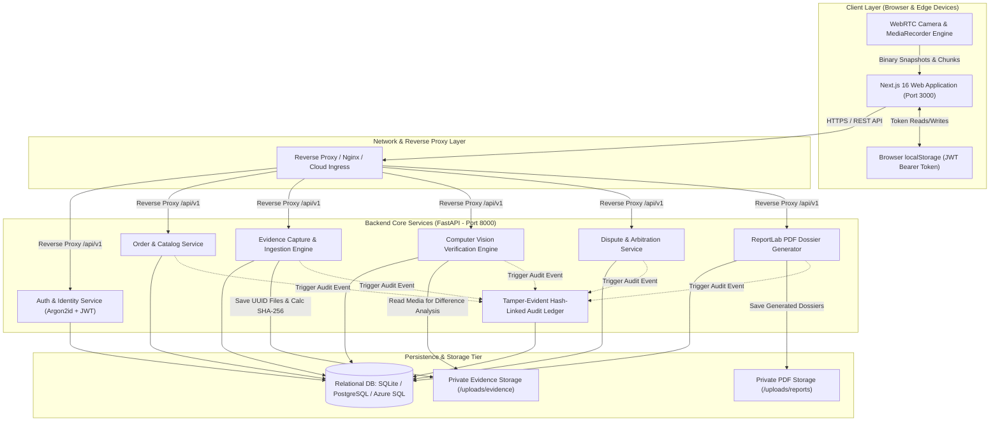
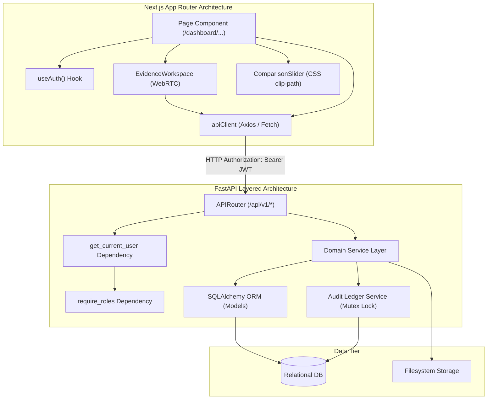
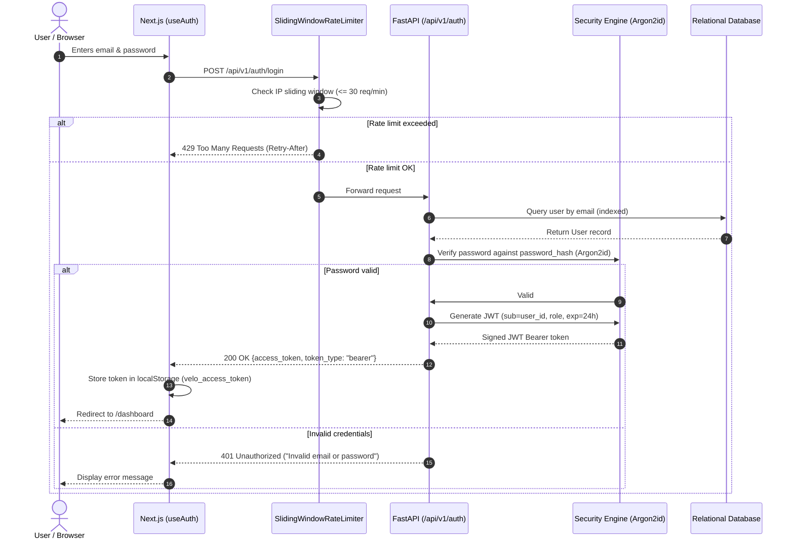
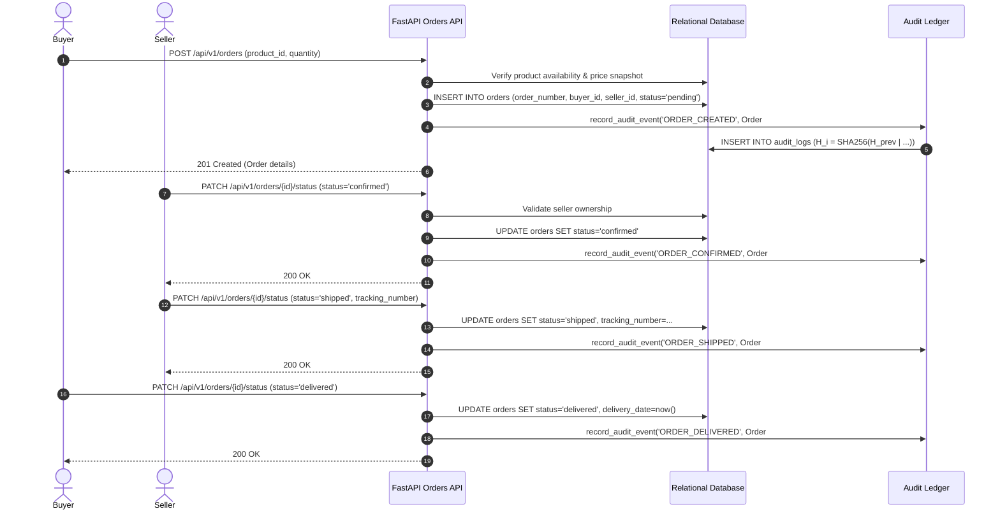
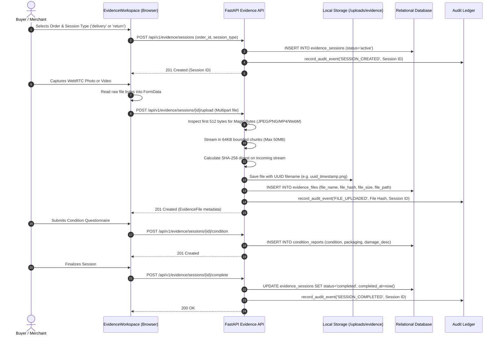
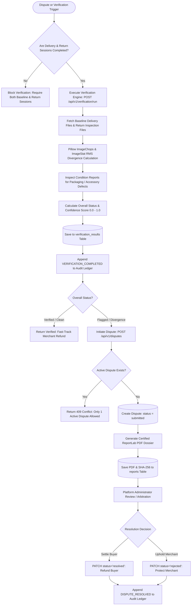

# VELO — COMPREHENSIVE SYSTEM DESIGN DOCUMENTATION

**Date of Publication:** November 8, 2026  
**Author / Architect:** Velo Lead Systems Architect & AppSec Quality Gate  
**Target Codebase:** Velo Chain-of-Custody & Return Verification Platform  
**Architecture Paradigm:** Decoupled Micro-Monolith (Next.js 16 App Router + FastAPI Core + Cryptographic Ledger)  

---

## 1. Problem Statement and System Requirements

### 1.1 Problem Statement
Modern e-commerce platforms suffer billions of dollars in annual losses resulting from fraudulent returns, transit damage claims, unverified "item not received" assertions, and item-swapping scams ("friendly fraud"). 

Traditional e-commerce platforms lack a verifiable, tamper-evident **digital chain-of-custody** connecting the physical state of a good at dispatch, its unboxing at delivery, and its packaging upon return. In standard dispute workflows, buyers and sellers submit unauthenticated, easily forged photographs, forcing platforms into subjective arbitration without objective cryptographic or computer vision proof.

### 1.2 System Requirements
Velo addresses this challenge by establishing an end-to-end custody verification system:
1. **Cryptographic Integrity:** Every uploaded photograph and video must be hashed server-side using SHA-256 upon raw binary ingestion, rejecting client-asserted hashes.
2. **Immutable Audit Ledger:** Every state transition (order, evidence upload, verification run, dispute update, PDF download) must append to a sequential, tamper-evident hash-linked audit trail.
3. **Hardware Capture Integration:** Real-time WebRTC camera snapshots and video recordings directly inside the browser workspace.
4. **Automated Visual Verification:** Algorithmic image difference comparison (RMS pixel divergence) to detect missing parts, structural divergence, and packaging defects between delivery and return states.
5. **Certified Legal Dossiers:** Compilation of tamper-evident PDF evidence reports with cryptographic page counts and sequential audit histories suitable for credit card chargeback arbitration and legal proceedings.

---

## 2. Functional Requirements

| Module | Implemented Functional Capabilities |
| :--- | :--- |
| **Authentication & RBAC** | • User registration with role designation (`buyer`, `seller`).<br>• Public administrative registration blocked (`403 Forbidden`).<br>• Password authentication using RFC 9106 Argon2id.<br>• Stateless JWT authentication (HS256) with 24-hour expiration.<br>• Role-based permission enforcement via FastAPI dependencies (`require_roles`). |
| **Product Catalog** | • Merchant product creation with unique SKU and hardware serial numbers.<br>• Catalog browsing, filtering by category/brand, and price management.<br>• SKU collision detection and prevention. |
| **Order Management** | • Unique order generation (`ORD-YYYYMMDD-XXXXXX`).<br>• Order lifecycle state machine (`pending` $\rightarrow$ `confirmed` $\rightarrow$ `shipped` $\rightarrow$ `delivered` $\rightarrow$ `return_requested` $\rightarrow$ `returned` / `cancelled`).<br>• Multi-tenant data isolation: buyers only access their purchases; merchants only access their sold products. |
| **Evidence Capture** | • Dual-session lifecycle: `delivery` (unboxing) and `return` (pre-shipment).<br>• Browser-based WebRTC live camera streaming (`navigator.mediaDevices.getUserMedia`).<br>• Off-screen HTML5 `<canvas>` snapshot extraction.<br>• MediaRecorder API video capture with live recording timers.<br>• Structured condition report questionnaires (packaging, seal, accessories, defect narrative). |
| **Evidence Ingestion** | • 64KB bounded streaming chunk uploads up to 50MB (`MAX_UPLOAD_SIZE_BYTES`).<br>• Binary magic byte validation for JPEG, PNG, WebP, MP4, and WebM.<br>• Private local filesystem storage with randomized UUID naming.<br>• Authenticated streaming endpoint (`/api/v1/evidence/file/{id}/download`). |
| **Cryptographic Ledger** | • Sequential hash chaining: $H_i = \text{SHA-256}(H_{i-1} \parallel \text{Event} \parallel \text{User} \parallel \text{Order} \parallel \text{Timestamp})$.<br>• Thread-safe atomic writes via `threading.RLock()`.<br>• Cryptographic ledger continuity verification endpoint (`/api/v1/evidence/audit/verify`). |
| **Visual Verification** | • Algorithmic image comparison using Pillow (`ImageChops`, `ImageStat`) calculating normalized RMS pixel divergence.<br>• Multi-dimensional scoring: identity, damage, accessories checklist, overall status, and confidence score ($0.0 \dots 1.0$).<br>• Transactional audit event recording (`VERIFICATION_COMPLETED`). |
| **Dispute Management** | • Standardized 6-reason dispute taxonomy.<br>• Duplicate dispute prevention (`409 Conflict`).<br>• Arbitration lifecycle management (`submitted` $\rightarrow$ `under_review` $\rightarrow$ `resolved` / `rejected`). |
| **Certified PDF Dossiers** | • Server-side ReportLab PDF generation.<br>• Two-pass `NumberedCanvas` rendering exact page totals ("Page X of Y").<br>• Inclusion of order specs, evidence SHA-256 tables, condition reports, and chronological audit ledger entries. |

---

## 3. Non-Functional Requirements

| Metric | Target Specification | Implemented Mechanism |
| :--- | :--- | :--- |
| **Security & Cryptography** | NIST / RFC compliant | RFC 9106 Argon2id (`m=65536, t=2, p=1`), HS256 JWT, SHA-256 binary digests. |
| **Brute-Force Protection** | $\le 30\text{ req/min}$ per IP | Thread-safe sliding-window rate limiter on authentication routes. |
| **Denial of Service (DoS)** | Memory bounded | 64KB bounded chunk streaming prevents RAM exhaustion on 50MB uploads. |
| **Data Isolation (BOLA)** | Zero unauthorized access | Ownership authorization dependencies enforce buyer, seller, or admin tenancy. |
| **Response Latency** | $< 50\text{ms}$ metadata, $< 500\text{ms}$ PDF | Indexed database lookups, stream response for files/PDFs. |
| **Maintainability** | Clean separation of concerns | Modular layered architecture: Routes $\rightarrow$ Services $\rightarrow$ Models $\rightarrow$ Schemas. |
| **Observability** | 12-Factor App logging | Structured stdout logging with timestamps, levels, and module identifiers. |

---

## 4. High-Level Architecture (HLD)

The system is architected as a decoupled micro-monolith consisting of a Next.js frontend client layer and a FastAPI backend service layer, operating over a shared relational database and private evidence media storage.



---

## 5. Low-Level Architecture (LLD)

### Directory & Package Structure

```
velo/
├── backend/
│   ├── alembic/                       # Database migration versions & env
│   ├── app/
│   │   ├── core/                      # Settings, security, rate limiting
│   │   │   ├── config.py              # Pydantic BaseSettings & validators
│   │   │   ├── security.py            # Argon2id hashing & JWT token handling
│   │   │   └── rate_limiter.py        # Sliding-window IP rate limiter
│   │   ├── database/                  # Database connectivity & base models
│   │   │   ├── base.py                # DeclarativeBase metadata
│   │   │   └── connection.py          # SessionLocal, get_db, pool settings
│   │   ├── models/                    # 10 SQLAlchemy Mapped entities
│   │   ├── routes/                    # FastAPI APIRouters
│   │   │   ├── api_v1.py              # Consolidated v1 router mount
│   │   │   ├── auth.py                # /auth/register, /auth/login, /auth/me
│   │   │   ├── products.py            # /products CRUD
│   │   │   ├── orders.py              # /orders CRUD & status transitions
│   │   │   ├── evidence.py            # /evidence sessions & streaming upload
│   │   │   ├── verification.py        # /verification run, status, history
│   │   │   ├── disputes.py            # /disputes filing & resolution
│   │   │   └── reports.py             # /reports generation & PDF streaming
│   │   ├── schemas/                   # Pydantic request/response contracts
│   │   ├── services/                  # Core domain & business logic
│   │   │   ├── auth_service.py
│   │   │   ├── product_service.py
│   │   │   ├── order_service.py
│   │   │   ├── evidence_service.py
│   │   │   ├── verification_service.py
│   │   │   ├── dispute_service.py
│   │   │   ├── report_service.py
│   │   │   └── audit_service.py
│   │   └── utils/                     # Logging & formatters
│   └── tests/                         # 11 automated pytest suites (81 tests)
├── frontend/
│   ├── src/
│   │   ├── app/                       # Next.js 16 App Router pages
│   │   │   ├── layout.tsx             # Root responsive viewport wrapper
│   │   │   ├── page.tsx               # Public landing page
│   │   │   ├── login/page.tsx         # User authentication portal
│   │   │   ├── register/page.tsx      # Buyer/seller registration portal
│   │   │   └── dashboard/             # Role-based workspace
│   │   │       ├── page.tsx           # Metrics & activity feed
│   │   │       ├── orders/            # Orders directory & details view
│   │   │       ├── products/          # Catalog management (seller)
│   │   │       ├── verification/      # Comparison slider & CV runner
│   │   │       ├── disputes/          # Arbitration claim filing & review
│   │   │       └── reports/           # PDF dossier download interface
│   │   ├── components/                # Reusable React 19 UI components
│   │   │   ├── evidence/              # WebRTC camera & capture workspace
│   │   │   ├── verification/          # Before/after comparison slider
│   │   │   └── layout/                # Navbar, Footer, Sidebar
│   │   ├── hooks/                     # Custom React hooks (useAuth)
│   │   ├── lib/                       # API client & configuration
│   │   ├── services/                  # Client-side API service wrappers
│   │   └── types/                     # TypeScript domain interfaces
├── docs/                              # Architecture, API & audit reports
└── uploads/                           # Private local storage (evidence & reports)
```

---

## 6. Component Architecture



---

## 7. Frontend-Backend Communication Flow

Communication between the Next.js frontend and FastAPI backend adheres to strict REST conventions:

1. **Authentication Token Storage:** Following login, the backend returns a JSON payload containing `access_token` and `token_type: "bearer"`. The client persists this token in browser `localStorage` under key `velo_access_token`.
2. **Automatic Request Header Injection:** All outgoing requests dispatched through `frontend/src/lib/apiClient.ts` attach the authorization header:
   ```http
   Authorization: Bearer <JWT_ACCESS_TOKEN>
   ```
3. **Multipart Form-Data Handling:** Evidence file uploads bypass standard JSON encoding. The client constructs native `FormData` instances containing raw binary `File` objects. The client omits manual `Content-Type` headers, enabling the browser to calculate multipart boundary delimiters.
4. **Error Mapping:** The backend returns standardized error envelopes (`{"detail": "..."}`). The frontend maps HTTP 400, 401, 403, 404, 409, and 422 into typed `ApiError` instances, rendering toast notifications or inline alerts.

---

## 8. Authentication and Authorization Flow



---

## 9. Order Lifecycle Sequence Diagram



---

## 10. Delivery and Return Evidence Sequence Diagram



---

## 11. Verification and Dispute Workflow



---

## 12. Database Architecture

The persistence architecture consists of 10 fully normalized relational entities operating in third normal form (3NF).

```
   ┌───────────────┐           ┌───────────────┐
   │     users     │           │   products    │
   └───────┬───────┘           └───────┬───────┘
           │                           │
           ├───────────────────────────┤
           │                           │
           ▼                           ▼
   ┌───────────────────────────────────────────┐
   │                  orders                   │
   └───────┬───────────┬───────────┬───────────┘
           │           │           │
     ┌─────┘           │           └─────┐
     ▼                 ▼                 ▼
┌──────────────┐┌──────────────┐┌──────────────┐
│evidence_sess.││  disputes    ││   reports    │
└───┬──────┬───┘└──────────────┘└──────────────┘
    │      │
    ▼      ▼
┌───────┐┌──────────────┐
│files  ││condition_rep.│
└───────┘└──────────────┘
```

Detailed database schema definitions, primary keys, foreign keys, constraints, normalization proofs, indexes, and queries are documented in [`docs/VELO_DBMS_DOCUMENTATION.md`](file:///c:/Users/rishi/OneDrive/Desktop/velo/docs/VELO_DBMS_DOCUMENTATION.md).

---

## 13. API Design

All endpoints reside under the `/api/v1` namespace.

| Route | HTTP Method | Protected | Required Roles | Description |
| :--- | :---: | :---: | :---: | :--- |
| `/auth/register` | `POST` | No | Public | Register new buyer or seller account. |
| `/auth/login` | `POST` | No | Public (Rate Limited) | Authenticate user; returns JWT token. |
| `/auth/me` | `GET` | **Yes** | Any Authenticated | Retrieve current user profile. |
| `/products` | `GET` | No | Public | List catalog products with filtering. |
| `/products` | `POST` | **Yes** | `seller`, `admin` | Create new catalog product. |
| `/orders` | `GET` | **Yes** | Any Authenticated | List orders filtered by user role. |
| `/orders` | `POST` | **Yes** | `buyer`, `admin` | Place a new purchase order. |
| `/orders/{id}` | `GET` | **Yes** | Parties to Order | Get order details and linked sessions. |
| `/orders/{id}/status` | `PATCH` | **Yes** | Parties to Order | Advance order lifecycle state. |
| `/evidence/sessions` | `POST` | **Yes** | Parties to Order | Create delivery or return evidence session. |
| `/evidence/sessions/{id}/upload` | `POST` | **Yes** | Parties to Order | Multipart binary file upload (50MB limit). |
| `/evidence/sessions/{id}/complete` | `POST`| **Yes** | Parties to Order | Finalize session and lock media. |
| `/evidence/file/{id}/download` | `GET` | **Yes** | Parties to Order | Authenticated private media file stream. |
| `/evidence/audit/verify` | `GET` | **Yes** | Any Authenticated | Verify cryptographic continuity of audit ledger. |
| `/verification/status` | `GET` | **Yes** | Any Authenticated | Query computer vision engine status. |
| `/verification/run` | `POST` | **Yes** | Parties to Order | Execute image comparison on delivery vs return. |
| `/verification/history` | `GET` | **Yes** | Parties to Order | List verification results for an order. |
| `/disputes` | `POST` | **Yes** | Parties to Order | File a formal dispute claim. |
| `/disputes/{id}/status` | `PATCH` | **Yes** | `admin` | Resolve or reject an active dispute. |
| `/reports/order/{id}` | `POST` | **Yes** | Parties to Order | Compile certified ReportLab PDF dossier. |
| `/reports/{id}/download` | `GET` | **Yes** | Parties to Order | Download compiled PDF evidence report. |
| `/reports/order/{id}/pdf` | `GET` | **Yes** | Parties to Order | Direct streaming alias for order PDF report. |
| `/health` | `GET` | No | Public | System liveness probe & database ping (`SELECT 1`). |

---

## 14. Error Handling and Failure Scenarios

### 14.1 Standardized Error Envelopes
All API errors return consistent RFC 7807 compliant JSON envelopes:
```json
{
  "detail": "Description of error or constraint failure."
}
```

### 14.2 Common Failure Scenarios & Mitigations

| Failure Scenario | Root Cause | Implemented System Response |
| :--- | :--- | :--- |
| **Invalid Credentials** | Bad email or password | HTTP `401 Unauthorized` with generic message to prevent email enumeration. |
| **Brute-Force Login Attack** | $> 30$ attempts / min | HTTP `429 Too Many Requests` with `Retry-After: <seconds>` header. |
| **Object Access Violation (BOLA)** | User queries order # they do not own | HTTP `403 Forbidden` (`Access denied to order resources`). |
| **Duplicate Dispute Filing** | Second dispute opened on same order | HTTP `409 Conflict` (`An active dispute already exists for this order`). |
| **Corrupted Media Upload** | Binary payload does not match extension | HTTP `400 Bad Request` (Magic byte validation failed). |
| **Oversized Media Upload** | Upload exceeds 50MB | Bounded chunk streaming aborts before memory overflow; HTTP `413 Request Entity Too Large`. |
| **Ledger Concurrency Race** | Simultaneous events attempting hash write | Re-entrant `threading.RLock()` serializes ledger writes, preserving chain hash integrity. |
| **Unhandled Exception** | Code exception during runtime | Global ASGI exception handler catches exception, logs traceback, and returns HTTP `500 Internal Server Error` without leaking stack traces. |

---

## 15. Scalability and Performance Considerations

### 15.1 Current Implementation Performance
- **Indexed Access:** All foreign keys, email lookups, order numbers, and hashes are indexed, achieving $O(1)$ or $O(\log N)$ lookup performance.
- **Chunked File Streaming:** Evidence ingestion processes 64KB chunks directly to disk without loading entire 50MB files into server memory.
- **Fast Startup:** Turbopack builds Next.js in $< 3\text{ seconds}$; FastAPI starts up in $< 1\text{ second}$.

### 15.2 Scalability Bottlenecks & Evolution Path
1. **Database:** SQLite is single-writer serialized. Moving to PostgreSQL or Azure SQL allows thousands of concurrent write transactions with connection pooling (`QueuePool`).
2. **File Storage:** Local disk storage cannot scale across multiple container instances. Moving to cloud object storage (Azure Blob Storage / AWS S3) allows infinite media scaling.
3. **Password Hashing:** Argon2id is intentionally CPU-intensive to resist GPU cracking. High-concurrency spikes should offload hashing to worker threads (`asyncio.to_thread`).

---

## 16. Reliability and Availability Considerations

1. **Database Reconnection (`pool_pre_ping=True`):** SQLAlchemy actively tests connections with `SELECT 1` before issuing queries, seamlessly discarding dead TCP sockets.
2. **Automated Health Probes:** The `/health` endpoint executes active database queries. Container orchestrators (Kubernetes / Azure App Service) leverage this for liveness and readiness restarts.
3. **Graceful UI Fallbacks:** If the verification engine returns an error or is unreachable, the frontend gracefully alerts the user without crashing the layout.

---

## 17. Security Boundaries

```
[ UNTRUSTED INTERNET ]
        │
        ▼
[ Security Boundary 1: Transport & Reverse Proxy ]
  - TLS 1.3 Termination (HTTPS)
  - Security Headers: HSTS, X-Frame-Options: DENY, nosniff
  - Max Body Size: 55MB
        │
        ▼
[ Security Boundary 2: FastAPI Application Boundary ]
  - Sliding-Window Rate Limiter (30 req/min)
  - CORS Whitelist (Restricts foreign browser origins)
  - JWT HS256 Token Verification (Sub, Exp, Signature)
        │
        ▼
[ Security Boundary 3: Domain Authorization & Tenancy ]
  - Role-Based Access Control (require_roles)
  - BOLA / IDOR Defense (Order ownership validation)
  - Magic Byte Binary Validation (Rejects executable payloads)
        │
        ▼
[ Security Boundary 4: Data & Storage Tier ]
  - Private File Storage (Outside web root; random UUID names)
  - Tamper-Evident SHA-256 Ledger (Thread mutex lock)
  - Parameterized SQLAlchemy Queries (SQL Injection defense)
```

---

## 18. Technology Selection and Trade-Offs

| Technology Choice | Primary Benefit | Trade-Off / Considered Alternatives |
| :--- | :--- | :--- |
| **Next.js 16 + React 19** | Modern App Router, Turbopack speed, wide 100vw layout flexibility, SSR capabilities. | Greater runtime complexity than a static SPA (Vite). Mitigated by Next.js standalone runner. |
| **FastAPI + Python 3.10+** | High-performance async ASGI, automatic OpenAPI/Swagger documentation, native Pydantic validation. | Single-threaded event loop requires careful handling of CPU-bound tasks (Argon2id, image processing). |
| **SQLAlchemy 2.0 (Mapped)** | Compile-time type safety, database engine portability (SQLite $\leftrightarrow$ PostgreSQL $\leftrightarrow$ MSSQL). | Steeper learning curve than raw SQL or lightweight query builders. |
| **RFC 9106 Argon2id** | Industry standard winner of Password Hashing Competition; supreme resistance to GPU/ASIC cracking. | Higher CPU consumption than bcrypt or PBKDF2 under extreme load. |
| **ReportLab (Python)** | Fine-grained canvas drawing, two-pass `NumberedCanvas` page counts, embedded tables and vector lines. | Complex imperative styling compared to HTML-to-PDF tools (e.g. WeasyPrint/Puppeteer). However, ReportLab produces zero headless browser overhead. |
| **Pillow Image Analysis** | Lightweight RMS pixel difference and structural divergence without heavy external AI dependencies. | Does not employ deep neural networks (CNNs). Suitable for deterministic pixel discrepancies and condition checks. |

---

## 19. Current Architectural Limitations

1. **Local Disk Ephemerality:** Media uploads and PDF reports reside in local directory `uploads/`. In multi-container cloud clusters, containers cannot share local disk.
2. **In-Memory Rate Limiting:** `SlidingWindowRateLimiter` stores request timestamps in a local Python dictionary. Across multiple server replicas, rate limit buckets are not shared.
3. **Single-Node SQLite Concurrency:** SQLite is restricted to a single writer. Concurrent high-volume writes will result in lock contention.
4. **Synchronous Image Comparison:** Image divergence calculations currently execute synchronously within the HTTP request thread. Heavy high-resolution comparisons should be offloaded to asynchronous background workers (Celery / Redis Queue).

---

## 20. Future Improvements (Roadmap)

The following architectural enhancements are planned for post-pilot enterprise scaling:

- [ ] **Distributed Cloud Storage Provider:** Abstract `evidence_service.py` to upload media directly to Azure Blob Storage / AWS S3 using pre-signed SAS URLs.
- [ ] **Redis Distributed Rate Limiting:** Replace in-memory `SlidingWindowRateLimiter` with an atomic Redis sliding-window counter (`aioredis`).
- [ ] **Asynchronous Task Queue (Celery / RabbitMQ):** Offload computer vision image comparison and ReportLab PDF compilation to background Celery workers, notifying clients via WebSockets.
- [ ] **Advanced Deep Learning Verification:** Augment Pillow RMS difference calculation with a fine-tuned Vision Transformer (ViT) or CLIP model to detect subtle serial number tampering and micro-scratches.
- [ ] **PostgreSQL / Azure SQL Migration:** Execute Alembic migrations against managed cloud database instances with automated Point-in-Time Recovery (PITR).

